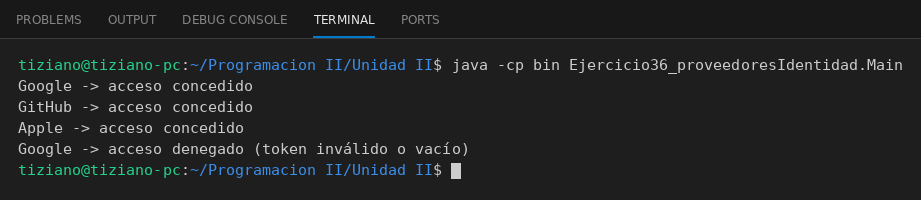

# ProveedorIdentidad

Programación II - Unidad 2 - Ejercicio 36

## Consigna
Validar tokens de proveedores de identidad externos con un contrato común.

## Lógica
- Clase abstracta `ProveedorIdentidad` con `nombreProveedor`, el método abstracto `validarToken(String)` y un helper que rechaza tokens nulos o vacíos.
- `AuthGoogle` (prefijo `ya29.`), `AuthGitHub` (prefijo `ghp_`) y `AuthApple` (longitud mínima).
- `Main`: tokens válidos y un token nulo, todo de forma polimórfica.

## Ejecución

